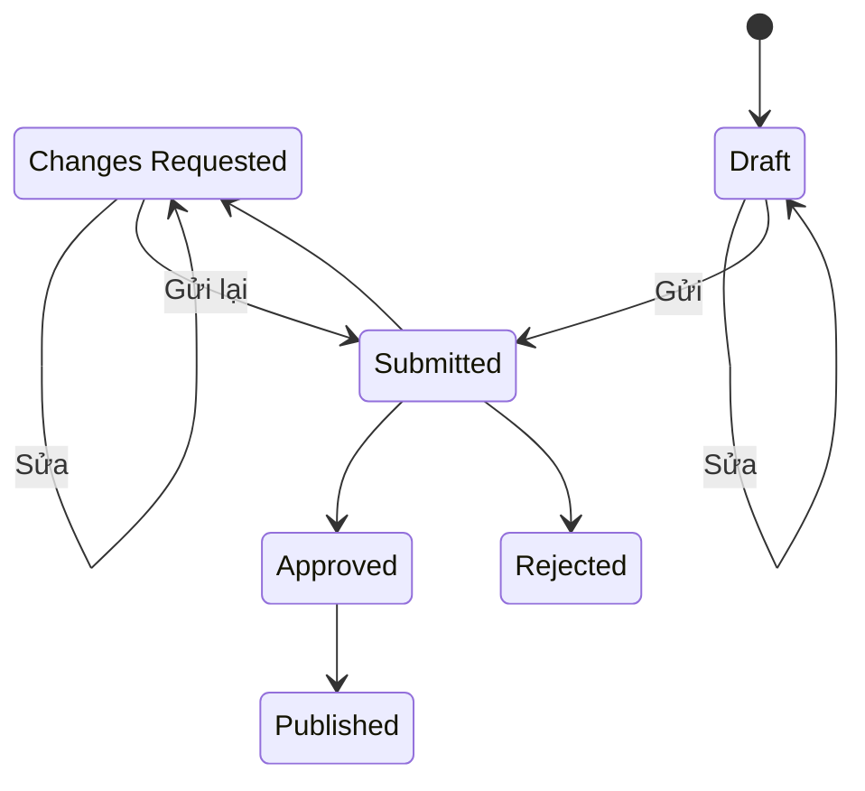
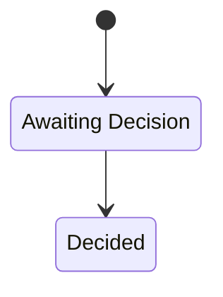
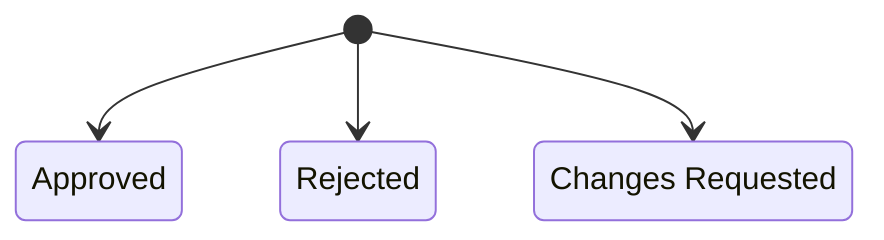
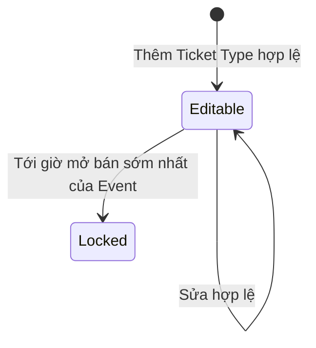
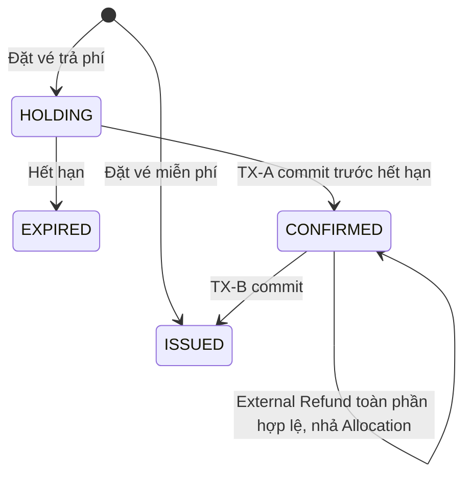
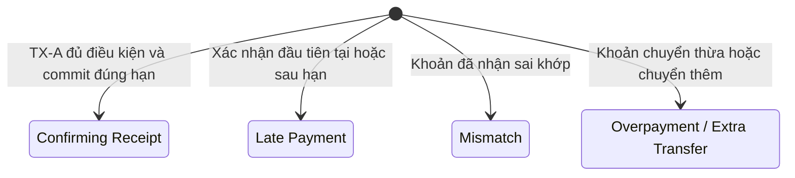
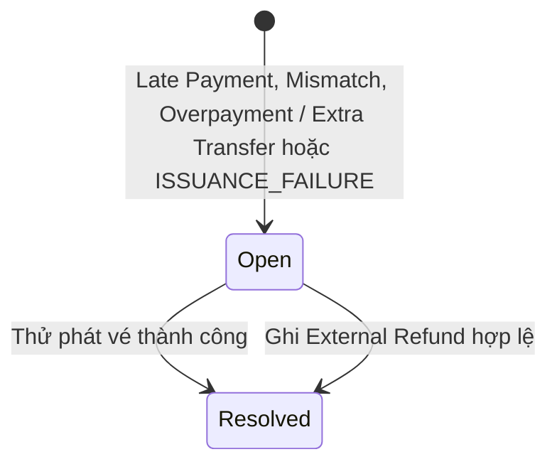
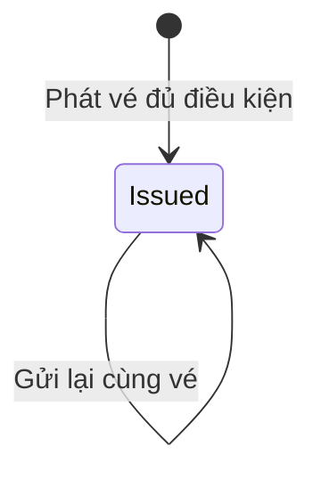
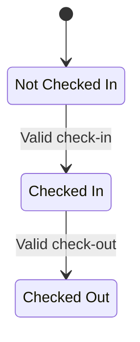

# Hợp đồng giữa các tính năng UniEvent

**Draft** · PA4.1 · Người duyệt **Kiệt**. Bản nháp dùng để thống nhất trạng thái, trường đọc/ghi và dữ liệu kiểm thử cho Setup v0. Sau PA5.1, mọi thay đổi hợp đồng phải qua PR được người phụ trách cả hai đầu điểm nối duyệt.

Nguồn [GLOSSARY.md](../../GLOSSARY.md), [UNIEVENT-SPEC.md](../requirements/UNIEVENT-SPEC.md), [ADR-001](adr/001-modular-monolith.md), [ADR-002](adr/002-postgresql-transactional-inventory.md), [ADR-003](adr/003-sepay-payment-fulfilment.md), [ADR-004](adr/004-same-site-hosting-and-session-cookies.md).

## A. Chuyển trạng thái

Nhãn tiếng Anh trong sơ đồ mô tả trạng thái hoặc kết quả nghiệp vụ. Các mã `HOLDING`, `CONFIRMED`, `ISSUED`, `EXPIRED` và `ISSUANCE_FAILURE` được dùng theo ADR. Dải FR dẫn đến mục tính năng khi đặc tả rút gọn chỉ nêu dải mã. Các thao tác thay đổi dữ liệu thuộc BR-11 ghi Audit Entry trong cùng giao dịch.

Tên trạng thái chưa có trong GLOSSARY là **đề xuất**: `Awaiting Decision`/`Decided` (Review Round), `Editable`/`Locked` (Ticket Type), `Open`/`Resolved` (Payment Exception), `Not Checked In`/`Checked In`/`Checked Out` (Attendance Record). Nếu Kiệt chấp nhận, bổ sung vào GLOSSARY trong Setup v0.

### Event

| Từ | Sang | F thực hiện | Điều kiện | Mã BR/FR |
| --- | --- | --- | --- | --- |
| ∅ | Draft | F02 | Organiser tạo Event trong Club của mình, đủ nội dung và hợp lệ theo F02. | BR-05–07, FR-F02-01–FR-F02-06 |
| Draft / Changes Requested | Giữ trạng thái hiện tại | F02 | Organiser sửa trong phạm vi Club. Giữ Club và Approval Route ban đầu. Từ chối nếu cấu hình vé hiện có sẽ vi phạm sức chứa hoặc giờ bán. | BR-05–07, FR-F02-01–FR-F02-06 |
| Draft / Changes Requested | Submitted | F02 | Gửi hoặc gửi lại theo Approval Route ban đầu. Giờ bắt đầu ở tương lai. Tạo Review Round mới và giữ lịch sử. | BR-05–07, FR-F02-01–FR-F02-06 |
| Submitted | Approved | F03 | Approver đúng Approval Unit, đồng thời không là Organiser của Club gửi. Lưu quyết định duy nhất của vòng. | BR-01–06, FR-F03-01–FR-F03-07 |
| Submitted | Rejected / Changes Requested | F03 | Cùng điều kiện duyệt, thêm lý do có nội dung. Đặc tả F03 kết thúc Event ở Rejected. | BR-01–06, FR-F03-01–FR-F03-07 |
| Approved | Published | F02 | Có ít nhất một Ticket Type cấu hình hợp lệ theo F04. Catalogue bắt đầu hiển thị dữ liệu công khai. | FR-F02-01–FR-F02-06, BR-12 |

### Review Round

| Từ | Sang | F thực hiện | Điều kiện | Mã BR/FR |
| --- | --- | --- | --- | --- |
| ∅ | Awaiting Decision | F02 | Mỗi lần gửi hoặc gửi lại tạo một vòng mới gắn với cùng Event. | BR-05–07, FR-F02-01–FR-F02-06 |
| Awaiting Decision | Decided | F03 | Lưu đúng một Review Decision cho vòng, kể cả khi quyết định đồng thời. Giữ vòng cũ trong lịch sử. | BR-01–06, FR-F03-01–FR-F03-07 |

### Review Decision

| Từ | Sang | F thực hiện | Điều kiện | Mã BR/FR |
| --- | --- | --- | --- | --- |
| ∅ | Approved | F03 | Vòng chưa có quyết định, Event đang Submitted và Approver đủ quyền theo điều kiện duyệt Event. | BR-01–06, FR-F03-01–FR-F03-07 |
| ∅ | Rejected / Changes Requested | F03 | Cùng điều kiện, kèm lý do có nội dung. Gửi lại sau Changes Requested tạo vòng mới. | BR-01–06, FR-F03-01–FR-F03-07 |

### Ticket Type và Configuration Lock

| Từ | Sang | F thực hiện | Điều kiện | Mã BR/FR |
| --- | --- | --- | --- | --- |
| ∅ / Editable | Editable | F04 | Organiser thêm hoặc sửa trước mốc khóa. Giá VND nguyên không âm, số lượng và giới hạn mỗi tài khoản nguyên dương. Tổng số lượng không vượt `capacity`, `sales_start < sales_end ≤ event_start`, giờ bán sớm nhất sau khi sửa vẫn ở tương lai. | BR-12, FR-F04-01–FR-F04-03 |
| Editable | Locked | F04 | Từ `sales_start` sớm nhất đang cấu hình cho Event, khóa thêm và sửa mọi Ticket Type của Event. | BR-12, FR-F04-01–FR-F04-03 |

### Reservation

| Từ | Sang | F thực hiện | Điều kiện | Mã BR/FR |
| --- | --- | --- | --- | --- |
| ∅ | HOLDING | F05 | Attendee đã xác minh, chưa bị khóa, đặt một vé của Event Published trong `[sales_start, sales_end)`. Kiểm tra tồn vé và giới hạn tài khoản, giữ một Allocation trong 15 phút theo giờ server, lưu giá tại lúc đặt. | BR-13–16, BR-18, FR-F05-01–FR-F05-05 |
| ∅ | ISSUED | F05 gọi F06 | Cùng điều kiện đặt vé. Với vé miễn phí, ghi Reservation, phân bổ Allocation và phát Ticket trong cùng giao dịch. Lỗi hoàn tác cả ba. Thử lại cùng mã yêu cầu trả kết quả của yêu cầu đó. | BR-14, FR-F05-01–FR-F05-05, FR-F06-01–FR-F06-07 |
| HOLDING | EXPIRED | F05 | Đến hạn mà Reservation chưa được xác nhận, nhả Allocation đúng một lần. | BR-18, BR-20, FR-F05-02 |
| HOLDING | CONFIRMED | F06 | TX-A xác thực và đối chiếu Payment Notification theo BR-17, loại khoản lặp, kiểm tra Allocation vẫn được giữ, lưu Confirming Receipt đầu tiên và commit chuyển trạng thái **trước** `expires_at` ban đầu. | BR-17, BR-20, FR-F06-01–FR-F06-07 |
| CONFIRMED | ISSUED | F06 | TX-B kiểm tra Allocation vẫn được giữ, phát hoặc dùng lại Ticket duy nhất của Reservation rồi commit. Nếu lỗi trước khi phát vé, giữ xác nhận và Allocation, ghi `ISSUANCE_FAILURE`. Gửi email sau commit. | BR-19, FR-F06-05 |
| CONFIRMED | CONFIRMED | F06 | Administrator ghi External Refund toàn phần hợp lệ cho Confirming Receipt trước khi phát vé. Cùng giao dịch ghi Audit Entry và nhả Allocation. Reservation giữ CONFIRMED để đối soát theo ADR-002. | BR-11, BR-19 |

Từ đúng mốc `expires_at`, xác nhận đầu tiên là trễ theo BR-20 hiện hành của PA2. TX-A và tác vụ hết hạn dùng cùng khóa Reservation theo ADR-003. Đề xuất PA3 dùng lần kiểm tra điều kiện cuối dưới khóa làm mốc vẫn chờ duyệt. Tồn vé và giới hạn mỗi tài khoản tính HOLDING còn hạn, CONFIRMED còn giữ Allocation và ISSUED. TX-B dùng cùng điều kiện về Allocation theo ADR-002.

### Payment Receipt

Sơ đồ mô tả cách phân loại khoản đã nhận. Confirming Receipt được xác định bằng liên kết từ Reservation. Tên nhóm trong sơ đồ dùng để đọc tài liệu.

| Từ | Sang | F thực hiện | Điều kiện | Mã BR/FR |
| --- | --- | --- | --- | --- |
| ∅ | Confirming Receipt | F06 | Payment Notification được xác thực. TX-A đối chiếu mã duy nhất, hóa đơn, kênh, phương thức, VND, số tiền và bộ giá trị `ORDER_PAID`, `CAPTURED`, `APPROVED`, `PAYMENT`, `BANK_TRANSFER`. Xác nhận đầu tiên đủ điều kiện, commit trước hạn và còn Allocation giữ. | BR-17, BR-20, FR-F06-01–FR-F06-07 |
| ∅ | Late Payment | F06 | Khoản đủ điều kiện đối chiếu cho xác nhận đầu tiên tại hoặc sau hạn. Lưu bằng chứng và Payment Exception. | BR-19–20, FR-F06-01–FR-F06-07 |
| ∅ | Mismatch | F06 | Ghi nhận khoản tiền đã về nhưng sai khớp qua Payment Exception. Liên kết Payment Receipt khi đối chiếu được Reservation. Trường hợp thiếu liên kết cần chốt ở mục D. | BR-17, BR-19, FR-F06-01–FR-F06-07 |
| ∅ | Overpayment / Extra Transfer | F06 | Khoản chuyển thừa hoặc khoản chuyển thêm. Ghi nhận Payment Exception và loại khỏi Gross Confirmed Revenue. Cách phân biệt với Mismatch cần chốt ở mục D. | BR-17, BR-19, BR-22, FR-F06-01–FR-F06-07 |
| Khoản đã ghi nhận | Giữ kết quả đã ghi nhận | F06 | Payment Notification lặp theo mã duy nhất của SePay. Xử lý idempotent, giữ Confirming Receipt đầu tiên và tính duy nhất của Ticket. | BR-17, FR-F06-01–FR-F06-07 |

Setup v0 dùng `PaymentReceipt` và đổi `confirming_payment_transaction_id` thành `confirming_payment_receipt_id`, giữ liên kết bất biến với Payment Receipt của cùng Reservation. [ADR-002](adr/002-postgresql-transactional-inventory.md)

### Payment Exception

| Từ | Sang | F thực hiện | Điều kiện | Mã BR/FR |
| --- | --- | --- | --- | --- |
| ∅ | Open | F06 | Khoản tiền đã về thuộc Late Payment, Mismatch hoặc Overpayment / Extra Transfer, hoặc TX-B lỗi trước khi phát vé trả phí (`ISSUANCE_FAILURE`). | BR-17, BR-19–20, FR-F06-01–FR-F06-07 |
| Open | Resolved | F06 | Administrator thử lại TX-B cho `ISSUANCE_FAILURE`. TX-B kiểm tra Allocation còn được giữ và commit phát Ticket thành công. | BR-19, FR-F06-05 |
| Open | Resolved | F06 | Administrator ghi External Refund toàn phần đã thực hiện bên ngoài cho một Payment Receipt đủ điều kiện, kèm chứng từ, số tiền, thời điểm, mã chuyển khoản duy nhất, lý do và bằng chứng đã báo người trả. Chặn ghi lặp hoặc hoàn vượt số tiền. Ghi Audit Entry và nhả Allocation đủ điều kiện trong cùng giao dịch. Hồ sơ hoàn một phần hoặc liên quan Ticket đã phát được giữ để xem xét riêng. | BR-11, BR-19, FR-F06-01–FR-F06-07 |

### Ticket

| Từ | Sang | F thực hiện | Điều kiện | Mã BR/FR |
| --- | --- | --- | --- | --- |
| ∅ | Issued | F05 gọi F06 / F06 | Vé miễn phí commit cùng Reservation và Allocation. Vé trả phí phát trong TX-B khi Reservation đủ điều kiện và còn Allocation. Mỗi Reservation có đúng một Ticket khi phát thành công, QR ký số không chứa dữ liệu cá nhân. | BR-14, BR-17, FR-F06-01–FR-F06-07 |
| Issued | Issued | F06 | Nếu gửi email lỗi sau commit, Ticket vẫn có trong My Tickets. Administrator có thể gửi lại chính Ticket đã phát. | FR-F06-01–FR-F06-07 |

### Attendance Record

| Từ | Sang | F thực hiện | Điều kiện | Mã BR/FR |
| --- | --- | --- | --- | --- |
| ∅ | Not Checked In | F06 → F07 | Ticket đã phát và chưa có check-in. Đây là trạng thái nghiệp vụ. Thời điểm tạo bản ghi cần chốt ở mục D. | BR-21, FR-F07-01–FR-F07-04 |
| Not Checked In | Checked In | F07 | Checker được gán đúng Event. Server kiểm tra QR, Event và Ticket. Ghi check-in đúng một lần, trả Scan Result Valid. | BR-21, FR-F07-01–FR-F07-04 |
| Checked In | Checked Out | F07 | Cùng điều kiện quét, đã check-in. Ghi check-out đúng một lần, trả Valid. | BR-21, FR-F07-01–FR-F07-04 |
| Trạng thái hiện tại | Giữ trạng thái hiện tại | F07 | Sai Event hoặc check-out trước check-in trả Invalid. Thử check-in sau check-out trả Already Used. Quét đồng thời chỉ ghi một lần mỗi bước. Khi lỗi mạng, đọc lại trạng thái server. | BR-21, FR-F07-01–FR-F07-04 |

## B. Điểm nối F01–F08

Tên trường kèm **(đề xuất)** cần chốt khi nối hai F. Các trường dẫn xuất có thể được trả qua giao diện module. Bên ghi chịu trách nhiệm cho thay đổi được nêu trong từng hàng.

| F nguồn | F đích | Thực thể | Trường bên đích đọc | Ai được ghi | Mã BR/FR |
| --- | --- | --- | --- | --- | --- |
| F01 | F02–F08 | Tài khoản, Role Assignment | `user_id` (đề xuất), `status` (đề xuất), `email_verified_at` (đề xuất), `role` (đề xuất), `scope_id` (đề xuất), `scope_type` (đề xuất) cho Club, Approval Unit hoặc Event | F01 quản lý trạng thái, xác minh và cấp/thu hồi quyền. Organiser gán/gỡ Checker qua F01. | BR-11, FR-F01-01–FR-F01-12 |
| F01 | F02, F03 | Organisation, Club, Approval Unit, Approval Route | `club_id` (đề xuất), `approval_unit_id` (đề xuất), `status` (đề xuất) | F01 quản lý Organisation. Mã, loại và Approval Route cố định từ lúc tạo. | BR-10, FR-F01-01–FR-F01-12, FR-F02-01–FR-F02-06, FR-F03-01–FR-F03-07 |
| F02 | F03 | Event, Review Round | `event_id` (đề xuất), `club_id` (đề xuất), `approval_unit_id` (đề xuất), `status` (đề xuất), `review_round_id` (đề xuất). Chi tiết để duyệt gồm `title` (đề xuất), `description` (đề xuất), `event_start`, `event_end` (đề xuất), `location` (đề xuất), `capacity` (đề xuất) và `poster` (đề xuất). | F02 ghi nội dung, lưu Club và Approval Route ban đầu, gửi Event và tạo vòng. F03 ghi kết quả duyệt vào trạng thái Event. | BR-05–07, FR-F02-01–FR-F02-06, FR-F03-01–FR-F03-07 |
| F03 | F02 | Event, Review Decision | `status` (đề xuất), `review_round_id` (đề xuất), `decision` (đề xuất), `reason` (đề xuất). F04 có cần Event đã Approved trước khi cấu hình vé hay không: xem mục D. | F03 ghi Review Decision và trạng thái sau duyệt. F02 đọc kết quả để gửi lại hoặc công bố. | BR-01–07, FR-F02-01–FR-F02-06, FR-F03-01–FR-F03-07 |
| F02 | F04 | Event | `event_id` (đề xuất), `club_id` (đề xuất), `capacity` (đề xuất), `event_start` | F02 ghi nội dung Event và kiểm tra cấu hình hiện có khi sửa dữ liệu ảnh hưởng tới vé. | FR-F02-01–FR-F02-06, BR-12 |
| F04 | F02 | Ticket Type, Sales Window | `event_id` (đề xuất), `name` (đề xuất), `price_vnd` (đề xuất), `quantity` (đề xuất), `per_account_limit` (đề xuất), `sales_start`, `sales_end`. F02 cần kết quả có ít nhất một Ticket Type hợp lệ khi công bố. | F04 ghi cấu hình. F02 ghi Published khi qua điều kiện công bố. | BR-12, FR-F02-01–FR-F02-06, FR-F04-01–FR-F04-03 |
| F02 | F05 | Event | `event_id` (đề xuất), `status` (đề xuất) bằng Published | F02 ghi trạng thái công bố. | BR-13–14, FR-F02-01–FR-F02-06, FR-F05-01–FR-F05-05 |
| F04 | F05 | Ticket Type, Sales Window | `ticket_type_id` (đề xuất), `event_id` (đề xuất), `price_vnd` (đề xuất), `quantity` (đề xuất), `per_account_limit` (đề xuất), `sales_start`, `sales_end`. Tồn vé được kiểm tra khi đặt vé theo ADR-002. | F04 ghi cấu hình. F05 ghi giữ/nhả suất theo hạn. F06 ghi kết quả thanh toán, phát vé và nhả suất đủ điều kiện theo BR-19. | BR-12–14, BR-19, FR-F05-01–FR-F05-05 |
| F05 | F06 | Reservation, Allocation | `reservation_id`, `status` (đề xuất), `attendee_id` (đề xuất), `ticket_type_id` (đề xuất), `price_vnd` (đề xuất, giá đã chốt), `invoice_code` (đề xuất), `expires_at` (đề xuất), `allocation_retained` (đề xuất, điều kiện dẫn xuất), `confirming_payment_receipt_id` | F05 tạo Reservation, lưu dữ liệu đặt vé và xử lý hết hạn. F06 ghi xác nhận, phát vé và xử lý giải phóng suất theo BR-19. | BR-14, BR-16–20, FR-F05-05, FR-F06-01–FR-F06-07 |
| F06 | F05 | Reservation | `status` (đề xuất), dùng cho kết quả trên trang quay về | F06 ghi CONFIRMED và ISSUED cho đơn trả phí. F05 đọc trạng thái từ server. | BR-17, BR-20, FR-F05-05 |
| F06 | F07 | Ticket, Reservation | `ticket_id`, `reservation_id`, `event_id` (đề xuất, đối chiếu Event qua Reservation và Ticket Type), `issued_at` (đề xuất cho trường lưu, phản ánh Ticket đã phát). F07 nhận QR đã ký từ lần quét. | F06 phát Ticket, gồm lượt F05 gọi khi đặt vé miễn phí. F07 xác thực vé và chỉ ghi Attendance Record. | BR-14, BR-21, FR-F06-01–FR-F06-07, FR-F07-01–FR-F07-04 |
| F06 | F08 | Ticket, Reservation, Payment Receipt, Confirming Receipt | `ticket_id`, `reservation_id`, `status` (đề xuất), `confirming_payment_receipt_id`, `amount_vnd` (đề xuất), `issued_at` (đề xuất cho trường lưu). Dùng dữ liệu đã commit để đếm vé và tính Gross Confirmed Revenue. | F06 ghi Ticket và Payment Receipt, chỉ gắn liên kết xác nhận ở TX-A. Ghi External Refund giữ nguyên liên kết. | BR-14, BR-17, BR-19–20, BR-22, FR-F08-01–FR-F08-03 |
| F07 | F08 | Attendance Record | `ticket_id`, `checked_in_at` (đề xuất), `checked_out_at` (đề xuất). `attendance_state` là cột xuất CSV. | F07 ghi giờ check-in và check-out thành công. F08 đọc dữ liệu đã commit. | BR-21–22, FR-F07-01–FR-F07-04, FR-F08-01–FR-F08-03 |
| F01, F02, F04, F05 | F08 | Tài khoản, Event, Ticket Type, Reservation | `attendee_id` (đề xuất), `display_name` (đề xuất), `email` (đề xuất), `event_id` (đề xuất), `title` (đề xuất), `ticket_type_id` (đề xuất), `name` (đề xuất) để xác định phạm vi và dựng CSV | F01 ghi hồ sơ, F02 ghi Event, F04 ghi Ticket Type, F05 liên kết Reservation với Attendee và Ticket Type. | BR-22, FR-F08-01–FR-F08-03 |
| F02, F03, F05, F06 | F01 | Event, Allocation, Payment Exception | `status` (đề xuất), `event_start`, `event_end` (đề xuất), `allocation_retained` (đề xuất). Dùng cùng quan hệ Organisation và Approval Route để kiểm tra điều kiện vô hiệu hóa. | F02/F03 ghi Event, F05/F06 cập nhật dữ liệu giữ suất, F06 xử lý Payment Exception. F01 quyết định vô hiệu hóa Organisation theo BR-10. | BR-10, FR-F01-01–FR-F01-12 |
| F01, F02, F03, F06, F08 | F01 (Administrator xem nhật ký) | Audit Entry | `actor_id` (đề xuất), `occurred_at` (đề xuất), `action` (đề xuất), `target` (đề xuất), `outcome` (đề xuất) | F thực hiện thao tác gọi hàm ghi `AuditLog` dùng chung trong cùng giao dịch (Setup v0, Học phụ trách). Không F nào sửa hoặc xóa Audit Entry. CSV ghi Audit Entry trước khi tải. | BR-11, FR-F01-12, FR-F08-01–FR-F08-03 |

F08 tính Gross Confirmed Revenue từ các Confirming Receipt đã commit, kể cả Reservation CONFIRMED chưa phát vé hoặc đã ghi External Refund. Vé miễn phí và khoản trễ, sai khớp hoặc chuyển thêm nằm ngoài tổng này. Check-in Rate dùng số Ticket đã từng check-in, gồm cả Checked Out, chia cho số Ticket đã phát, làm tròn một chữ số thập phân, mặc định 0,0%. CSV có một dòng cho mỗi Ticket đã phát trong phạm vi Event, với `check_in_at` và `check_out_at` là tên cột xuất.

## C. Fixture Setup v0 theo trạng thái

Mã dưới đây là ID cố định cho dữ liệu giả lập. `now` là giờ server lúc seed. Với Reservation trả phí, tính `expires_at` bằng thời điểm tạo cộng 15 phút. Ví dụ `res_holding_fresh` tạo tại `now − 5 phút`, hết hạn `now + 10 phút`. `res_holding_expired` tạo tại `now − 16 phút`, hết hạn `now − 1 phút`, đang chờ tác vụ đổi trạng thái. Mốc Sales Window và Event cũng đặt tương đối theo `now`.

| Mã fixture | Thực thể | Trạng thái và mô tả | F dùng để test |
| --- | --- | --- | --- |
| `org_club_a`, `org_unit_a` | Organisation, Club, Approval Unit | Cùng hoạt động. Approval Route của `org_club_a` trỏ đến `org_unit_a`. | F01, F02, F03, F04, F08 |
| `org_club_b`, `org_unit_b` | Organisation, Club, Approval Unit | Cùng hoạt động, tuyến duyệt độc lập để thử sai phạm vi. | F01, F02, F03, F08 |
| `org_club_disabled` | Organisation, Club | Đã vô hiệu hóa, dữ liệu mẫu phục vụ kiểm tra Organisation. | F01 |
| `usr_attendee` | Tài khoản | Attendee đã xác minh, đang hoạt động. | F01, F05, F06, F08 |
| `usr_attendee_locked`, `usr_attendee_unverified` | Tài khoản | Attendee đã xác minh nhưng bị khóa, và tài khoản đăng ký chưa xác minh. | F01, F05 |
| `usr_organiser_club_a`, `usr_approver_unit_a` | Tài khoản, Role Assignment | Organiser của `org_club_a` và Approver của `org_unit_a`, hai tài khoản độc lập. | F01, F02, F03, F04, F08 |
| `usr_organiser_approver_a` | Tài khoản, Role Assignment | Cùng có quyền Organiser của Club gửi và Approver của Approval Unit nhận. Thử từ chối quyết định. | F01, F03 |
| `usr_checker_evt`, `usr_checker_other_evt` | Tài khoản, Role Assignment | Checker được gán lần lượt cho `evt_published_paid` và `evt_published_free`. | F01, F07 |
| `usr_admin` | Tài khoản | Administrator đang hoạt động. | F01, F06 |
| `evt_draft` | Event | Draft, chưa gửi duyệt. | F02, F03 |
| `evt_submitted`, `rr_awaiting` | Event, Review Round | Submitted, đã tới đúng Approval Unit, vòng đang chờ quyết định. | F01, F02, F03 |
| `evt_changes_requested`, `rr_changes`, `rd_changes` | Event, Review Round, Review Decision | Changes Requested, vòng đã có quyết định kèm lý do. Dùng để sửa và gửi vòng mới. | F02, F03 |
| `evt_approved_no_tickets`, `rr_approved`, `rd_approved` | Event, Review Round, Review Decision | Approved, có quyết định Approved và chưa có Ticket Type. | F02, F03, F04 |
| `evt_approved_ready` | Event | Approved, có Ticket Type hợp lệ `tt_before_lock`. | F02, F04 |
| `evt_rejected`, `rr_rejected`, `rd_rejected` | Event, Review Round, Review Decision | Rejected, quyết định có lý do. | F02, F03 |
| `evt_published_paid`, `evt_published_free` | Event | Published, ban đầu đang bán. Loại vé tương ứng có giá dương hoặc bằng 0. | F02, F04, F05, F06, F07, F08 |
| `evt_published_presale`, `evt_published_sales_closed` | Event | Published, Sales Window tương ứng chưa mở hoặc đã đóng. | F04, F05 |
| `tt_before_lock`, `tt_presale` | Ticket Type, Sales Window | Editable, giờ mở bán ở tương lai. Lần lượt thuộc `evt_approved_ready` và `evt_published_presale`. | F02, F04, F05 |
| `tt_locked`, `tt_free_open` | Ticket Type, Sales Window | Locked, đang trong Sales Window của `evt_published_paid` và `evt_published_free`. | F04, F05, F06 |
| `tt_locked_future`, `tt_sales_closed` | Ticket Type, Sales Window | `tt_locked_future` chưa tới giờ mở bán riêng nhưng `tt_locked` đã khóa cấu hình của cùng Event. `tt_sales_closed` thuộc `evt_published_sales_closed`. | F04, F05 |
| `alloc_available` | Allocation | Một suất trống của `tt_locked`, chưa có Reservation giữ hoặc dùng. | F05, F06 |
| `res_holding_fresh`, `res_holding_expired` | Reservation, Allocation | HOLDING còn hạn và HOLDING đã qua hạn theo mốc seed nêu trên. Ca sau chưa chạy tác vụ hết hạn. | F05, F06 |
| `res_expired` | Reservation, Allocation | EXPIRED, Allocation đã nhả. Dùng cho khoản hợp lệ đến trễ. | F05, F06 |
| `res_confirmed_unissued` | Reservation, Allocation | CONFIRMED, vẫn giữ Allocation, có `rcpt_confirming` và `pex_issuance_failure`. | F05, F06, F08 |
| `res_confirmed_refunded`, `rcpt_confirming_refunded`, `refund_full` | Reservation, Confirming Receipt, External Refund | CONFIRMED, có External Refund toàn phần hợp lệ của Confirming Receipt và đã nhả Allocation, chưa có Ticket. | F05, F06, F08 |
| `res_issued_paid`, `rcpt_confirming_paid` | Reservation, Confirming Receipt | ISSUED sau TX-B, giữ Allocation và có `tkt_issued_unchecked`. | F05, F06, F07, F08 |
| `res_issued_free` | Reservation, Allocation | ISSUED ngay khi tạo thành công theo BR-14, có `tkt_issued_free` và không có Confirming Receipt. | F05, F06, F07, F08 |
| `rcpt_confirming` | Payment Receipt, Confirming Receipt | Xác nhận đầu tiên, TX-A đã commit đúng hạn cho `res_confirmed_unissued`. | F06, F08 |
| `rcpt_late`, `pex_late_payment` | Payment Receipt, Payment Exception | Khoản hợp lệ nhưng trễ cho `res_expired`. Ngoại lệ Open, không gắn làm Confirming Receipt. | F06, F08 |
| `rcpt_mismatch`, `pex_mismatch` | Payment Receipt, Payment Exception | Khoản có thể liên kết Reservation nhưng sai khớp và chưa xác nhận. Ngoại lệ Open. | F06, F08 |
| `rcpt_extra`, `pex_extra` | Payment Receipt, Payment Exception | Khoản chuyển thêm khác mã khoản xác nhận của `res_issued_paid`. Ngoại lệ Open. | F06, F08 |
| `pex_issuance_failure` | Payment Exception | Open, `ISSUANCE_FAILURE` của `res_confirmed_unissued`. Dùng thử phát lại. | F01, F06 |
| `pex_resolved_retry`, `pex_resolved_refund` | Payment Exception | Resolved sau lần thử phát thành công của `res_issued_paid`, hoặc sau ghi `refund_full` cho `res_confirmed_refunded`. | F06 |
| `tkt_issued_unchecked`, `tkt_issued_free` | Ticket, Attendance Record | Ticket đã phát, Not Checked In. Vé trả phí thuộc `res_issued_paid`, vé miễn phí thuộc `res_issued_free`. | F06, F07, F08 |
| `res_issued_for_check_in`, `res_issued_for_check_out` | Reservation, Confirming Receipt | Hai Reservation ISSUED của `tt_locked`, mỗi đơn có một Confirming Receipt riêng (`rcpt_check_in`, `rcpt_check_out`). | F06, F07, F08 |
| `tkt_checked_in`, `tkt_checked_out` | Ticket, Attendance Record | Ticket của `res_issued_for_check_in` chỉ có giờ check-in. Ticket của `res_issued_for_check_out` có cả giờ check-in và check-out. | F07, F08 |
| `audit_payment_resolution`, `audit_csv_export` | Audit Entry | Bản ghi bất biến cho ghi `refund_full` và cho lượt xuất CSV trong phạm vi Event. | F01, F06, F08 |

Guest dùng phiên chưa đăng nhập. Khi thử sai Event, dùng `usr_checker_evt` quét vé `tkt_issued_free`. Khi thử BR-20, dùng cùng mốc `expires_at` để đối chiếu commit trước hạn, đúng hạn và sau hạn. Khi thử quét lại, dùng chính Ticket đã có trạng thái tham dự tương ứng.

## D. Câu hỏi mở

| Mã BR/FR | Cần chốt | Người đề nghị xử lý |
| --- | --- | --- |
| BR-20, FR-F05-02, FR-F06-01–FR-F06-07 | Cách chứng minh TX-A đã commit trước `expires_at` khi cạnh tranh với tác vụ hết hạn, và xử lý bằng chứng khoản trễ khi TX-A hụt hạn. PA2 vẫn dùng mốc commit. Đề xuất PA3 dùng lần kiểm tra cuối dưới khóa đang chờ duyệt. | Huy chốt luật, Kiệt chốt điểm nối F05/F06 |
| BR-19, BR-22, FR-F06-01–FR-F06-07 | ADR-002 giữ CONFIRMED sau khi hoàn toàn phần cho Confirming Receipt trước lúc phát vé. Đặc tả rút gọn nêu nhả suất nhưng chưa nói trạng thái cuối, cách biểu diễn Allocation đã nhả, hoặc khoản hoàn cho Payment Receipt khác có ảnh hưởng đến suất của cùng Reservation hay không. | Huy chốt điều kiện, Kiệt chốt biểu diễn |
| BR-17, BR-19, BR-20, FR-F06-01–FR-F06-07 | Tiêu chí tách Late Payment, Mismatch và khoản chuyển thừa/chuyển thêm khi một khoản thỏa nhiều dấu hiệu. Cần chốt ánh xạ các trường IPN dùng để đối chiếu và cách lưu bằng chứng khi hóa đơn không xác định được Reservation. | Huy chốt phân loại, Kiệt chốt điểm nối |
| BR-19, FR-F06-05 | Cần ghi những kết quả xử lý nào cho hồ sơ hoàn một phần hoặc liên quan Ticket đã phát? Khi nào Payment Exception được coi là Resolved sau khi thử phát lại hoặc ghi hoàn tiền? | Huy chốt luật, Kiệt chốt dữ liệu kết quả |
| BR-05–07, FR-F02-01–FR-F02-06, FR-F03-01–FR-F03-07 | F03 xác định Rejected kết thúc Event đó. Xác nhận cách xử lý yêu cầu nộp lại nội dung từng bị từ chối, gồm việc có cần Event mới hay có quy trình khác. Chốt cách F02/F03 xác định vòng hiện tại và vòng đã quyết định. | Huy chốt nghiệp vụ, Kiệt chốt điểm nối |
| BR-12, FR-F04-01–FR-F04-03, FR-F02-01–FR-F02-06 | Configuration Lock tính từ `sales_start` hay cần lưu trường riêng? Chốt các trạng thái Event được cấu hình Ticket Type và nội dung kiểm tra khi F02 công bố một Event đã có cấu hình. | Kiệt chốt điểm nối, Huy chốt điều kiện |
| BR-14, FR-F05-01–FR-F05-05, FR-F06-01–FR-F06-07 | Vé miễn phí chỉ có ISSUED sau commit theo BR-14. Chốt phản hồi khi yêu cầu lặp hoặc phát vé thất bại và dữ liệu F05/F06 trao đổi trong giao dịch đó. | Huy chốt kết quả mong đợi, Kiệt chốt điểm nối |
| BR-21, FR-F06-01–FR-F06-07, FR-F07-01–FR-F07-04 | Ticket có trạng thái nghiệp vụ nào khác Issued trong phạm vi hiện tại? Chốt dữ liệu để F07 kiểm tra trạng thái vé và liên kết vé với Event. | Huy chốt luật, Kiệt chốt điểm nối |
| BR-21–22, FR-F07-01–FR-F07-04, FR-F08-01–FR-F08-03 | Tạo Attendance Record cùng Ticket hay ở lần check-in đầu? Chốt tên trường thời gian, cách suy ra `attendance_state` và Scan Result/thời điểm trả về khi lặp check-in hoặc check-out. | Kiệt chốt biểu diễn, Huy chốt kết quả quét |
| BR-22, FR-F08-01–FR-F08-03 | Chốt bộ giá trị `payment_status` trong CSV, nhất là vé miễn phí, và ánh xạ trường nguồn sang các cột tên, thời điểm và trạng thái. | Huy chốt ý nghĩa, Kiệt chốt ánh xạ |
| BR-10–11, FR-F01-01–FR-F01-12 | Chốt phạm vi và điều kiện gán Checker, danh sách trường của Role Assignment và Audit Entry, cùng cách F01 đọc các dữ liệu chặn vô hiệu hóa Organisation, gồm khoảng thời gian được coi là sự kiện sắp diễn ra. | Huy chốt điều kiện, Kiệt chốt điểm nối |
| BR-05–07, BR-12, BR-19, BR-21 | Các tên trạng thái đề xuất ở đầu mục A (Review Round, Ticket Type, Payment Exception, Attendance Record) có cần lưu thành enum hay chỉ là trạng thái dẫn xuất? Chốt tên trước khi viết schema Setup v0 và thêm vào GLOSSARY. | Kiệt chốt tên, Học cập nhật GLOSSARY |
| FR-F01-01–FR-F01-12, FR-F02-01–FR-F02-06, FR-F03-01–FR-F03-07, FR-F04-01–FR-F04-03, FR-F05-01–FR-F05-05, FR-F06-01–FR-F06-07, FR-F07-01–FR-F07-04, FR-F08-01–FR-F08-03 | Đặc tả rút gọn nêu dải FR theo F. Bổ sung ánh xạ từng chuyển trạng thái và điểm nối đến FR cụ thể khi nội dung của từng mã có trong Markdown. | Huy bổ sung ánh xạ, Kiệt rà các điểm nối |
